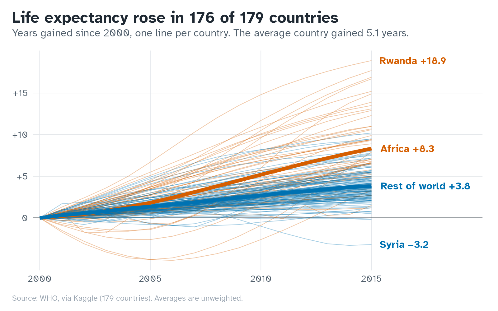
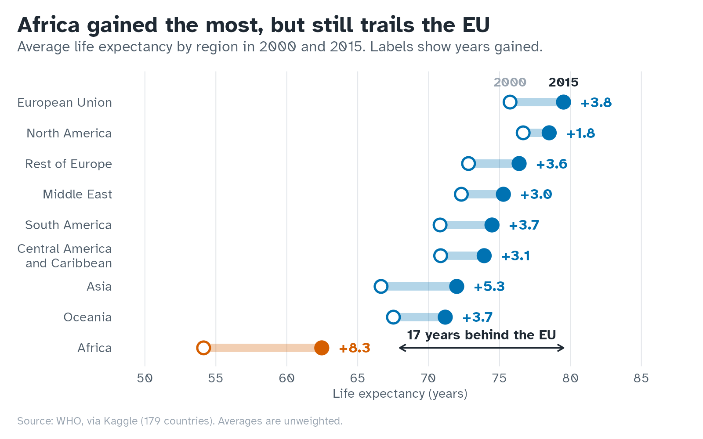
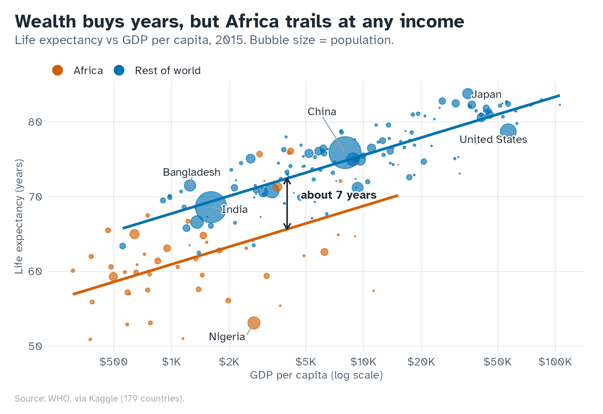
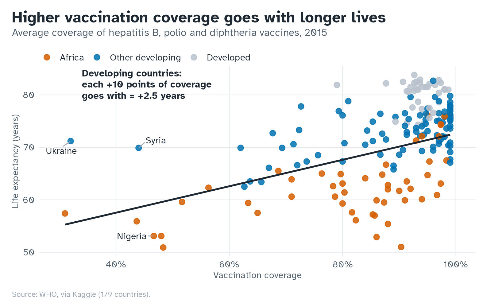
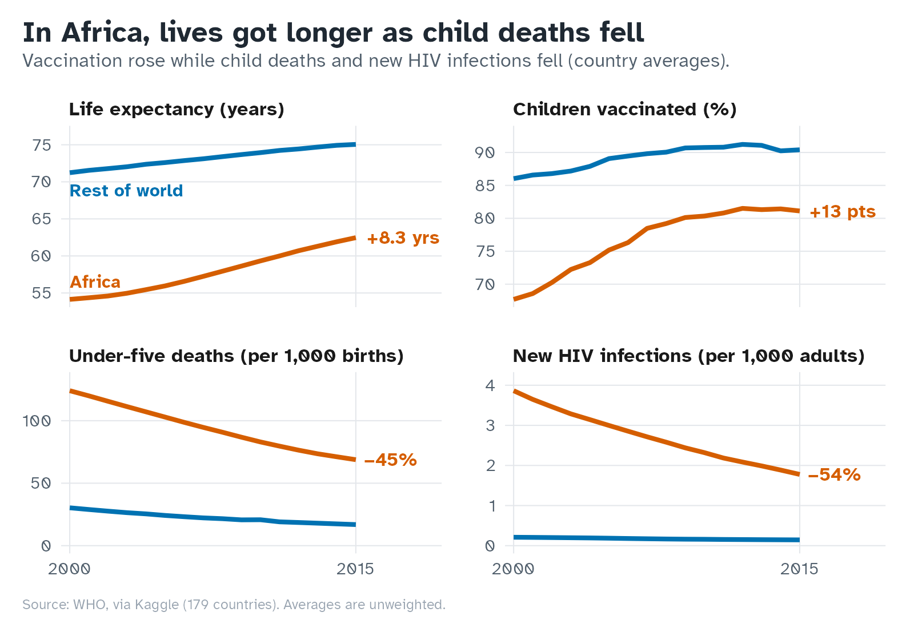

# Life expectancy, 2000–2015

Life expectancy rose in 176 of 179 countries. Africa gained the most and still has the furthest to go.

An exploratory analysis of WHO country data, in R.

## Almost everyone gained years

The average country gained **5.1 years**, from 66.4 to 71.5. Only 3 of 179 countries did not improve.



## Africa gained the most

Africa added **8.3 years**, against 3.8 for the rest of the world, and the ten biggest gains are all African. The gap to the EU narrowed from 22 to 17 years, which is still large.



## Wealth buys years, but not equally

The richest fifth of countries live **18 years** longer than the poorest fifth. At the same income, African countries live about **7 years** less.



## Vaccination goes with longer lives

Among developing countries, each 10 points of vaccination coverage goes with about **2.5 more years**. Developed countries are already near the ceiling, at 94% coverage on average.



## What changed in Africa

Since 2000, vaccination coverage rose 13 points, under-five deaths fell **45%** and new HIV infections fell **54%**.



These are associations, not proof of cause: richer countries tend to do better on everything. Averages count each country once, whatever its population.

## Data

WHO life expectancy data (updated version) for 179 countries, 2000–2015, from [Kaggle](https://www.kaggle.com/datasets/lashagoch/life-expectancy-who-updated). The file is not included in this repository. Download it into `data/`:

```sh
curl -L -o data.zip "https://www.kaggle.com/api/v1/datasets/download/lashagoch/life-expectancy-who-updated"
unzip data.zip -d data && rm data.zip
```

Or save it by hand as `data/Life-Expectancy-Data-Updated.csv`.

## Run it

From the project root. Missing packages install on the first run.

```sh
Rscript scripts/02_figures.R      # rebuild the figures
Rscript scripts/03_key_numbers.R  # print every number quoted above
```

`scripts/01_eda.R` is the full exploratory analysis; open it in RStudio and run it section by section. Figures use the Atkinson Hyperlegible font when it is installed and the system sans font otherwise.

```
scripts/
├── 00_clean.R        import and clean the data (sourced by the others)
├── 01_eda.R          exploratory plots, shown interactively
├── 02_figures.R      the five figures above
├── 03_key_numbers.R  the numbers quoted above
└── theme.R           ggplot2 theme and colours
figures/              PNGs written by 02_figures.R
data/                 not included, see Data
```
