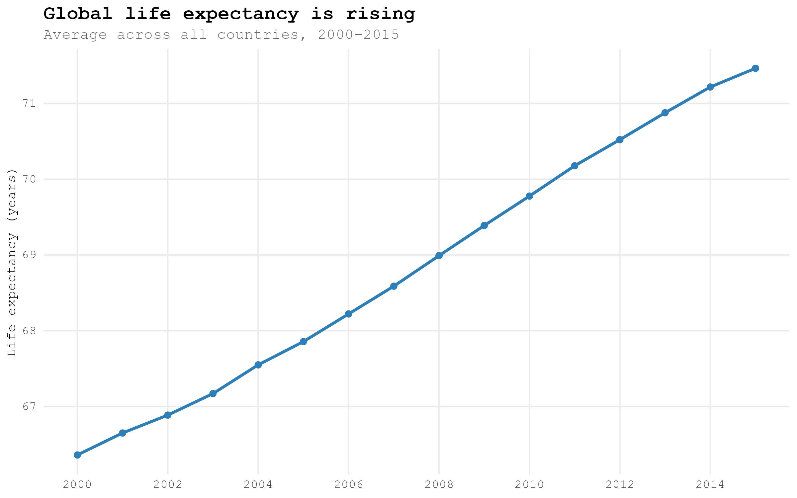
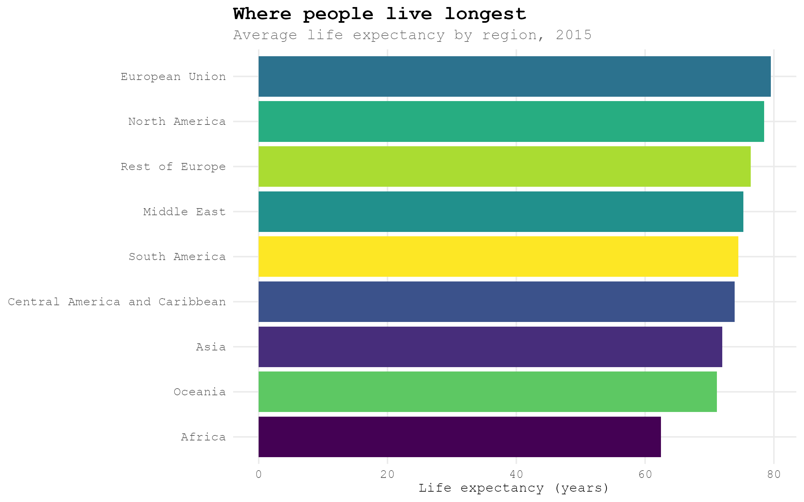
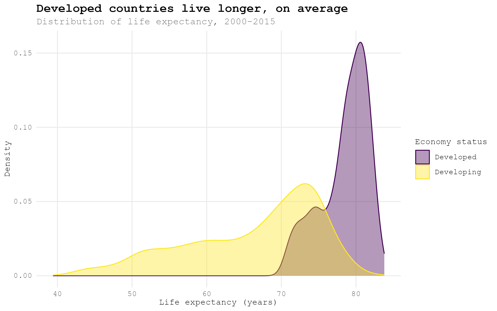
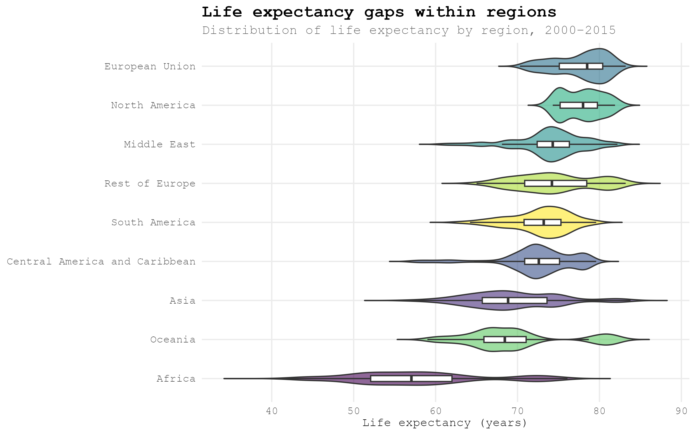
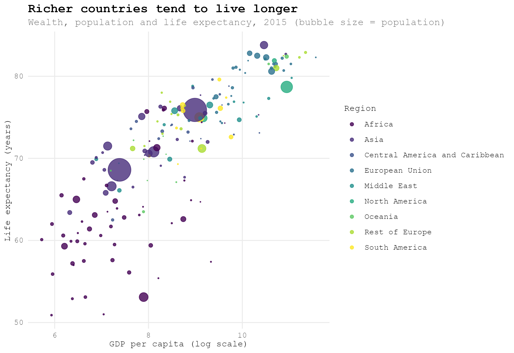
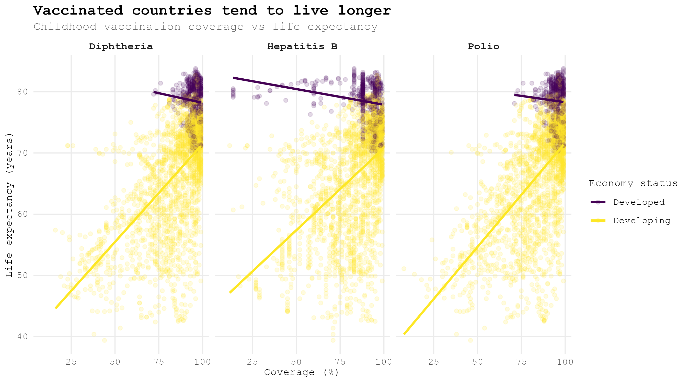

# Life Expectancy — Exploratory Data Analysis

## Overview

This project explores global life expectancy patterns using a country-year panel dataset spanning 2000–2015. It examines the relationships between life expectancy and health indicators, economic development, vaccination coverage, and regional trends. All analysis is conducted in R using the tidyverse ecosystem.

## What we found

**People are living longer almost everywhere.** Global average life expectancy rose from 66.4 years in 2000 to 71.5 years in 2015 — about five extra years in just fifteen years.



**Where you're born still matters a lot.** The gap between regions is stark: someone in the European Union can expect to live to about 80, while someone in Africa can expect around 62 — a 17-year difference.



**Wealthier countries live longer, but the gap is closing.** Developed countries average 78.5 years versus 66.3 for developing countries. The two distributions still overlap quite a bit, which means plenty of developing countries are catching up.



**Regions aren't uniform inside themselves either.** Africa shows the widest spread of any region — some African countries already match the global average, while others lag far behind. Most other regions are more tightly clustered.



**Money tends to buy years.** Plotting wealth against life expectancy (bubble size shows population) shows a strong relationship — richer countries cluster in the top right, living longer on higher incomes.



**Vaccines line up with longer lives, especially in developing countries.** Among developing countries, higher childhood vaccination coverage (Hepatitis B, Polio, Diphtheria) tracks closely with higher life expectancy. Developed countries are already near-universally vaccinated, so there's less room for the pattern to show up there.



## Structure

```
life-expectancy/
├── README.md
├── .gitignore
├── scripts/
│   ├── 00_clean.R   # Import and clean the raw data (sourced by the scripts below)
│   ├── 01_eda.R     # Full exploratory analysis (plots are interactive, not saved)
│   ├── 02_figures.R # Generates the polished plots shown in this README
│   └── theme.R      # Custom ggplot2 theme
├── figures/         # PNGs generated by 02_figures.R, used in this README
└── data/            # Not included — see Data section below
```

## Data

Data is not included in this repository.

The analysis uses `Life-Expectancy-Data-Updated.csv`, an updated version of the WHO Life Expectancy dataset. It contains country-year observations with variables including life expectancy, adult and infant mortality rates, vaccination coverage (Hepatitis B, Polio, Diphtheria), BMI, alcohol consumption, GDP per capita, schooling years, population, and regional and development-status classifications.

The dataset is publicly available on Kaggle:
[https://www.kaggle.com/datasets/lashagoch/life-expectancy-who-updated](https://www.kaggle.com/datasets/lashagoch/life-expectancy-who-updated)

Place the downloaded file at `data/Life-Expectancy-Data-Updated.csv` before running the scripts.

## Usage

1. Download the dataset from Kaggle and place it at `data/Life-Expectancy-Data-Updated.csv`.
2. Open an R session with the project root as the working directory.
3. Run `scripts/01_eda.R` to reproduce the full exploratory analysis.
4. Run `scripts/02_figures.R` to regenerate the plots used in this README.
